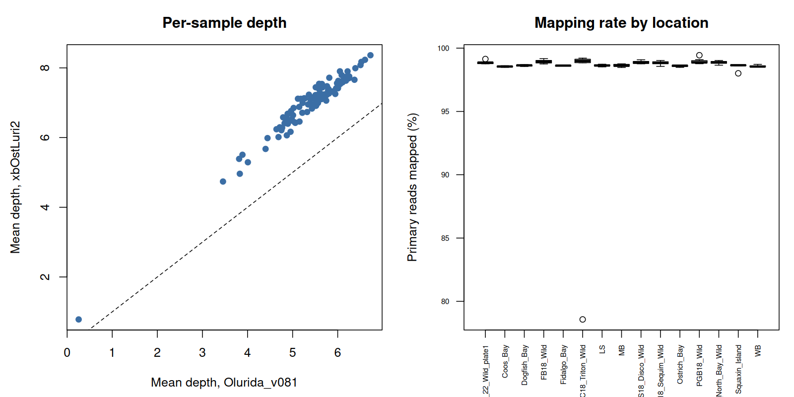
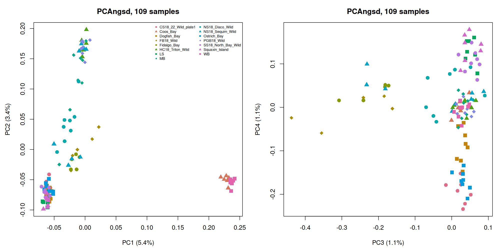
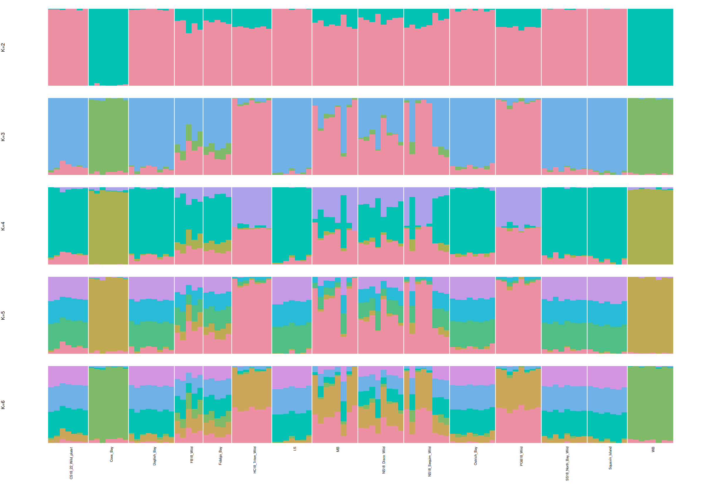
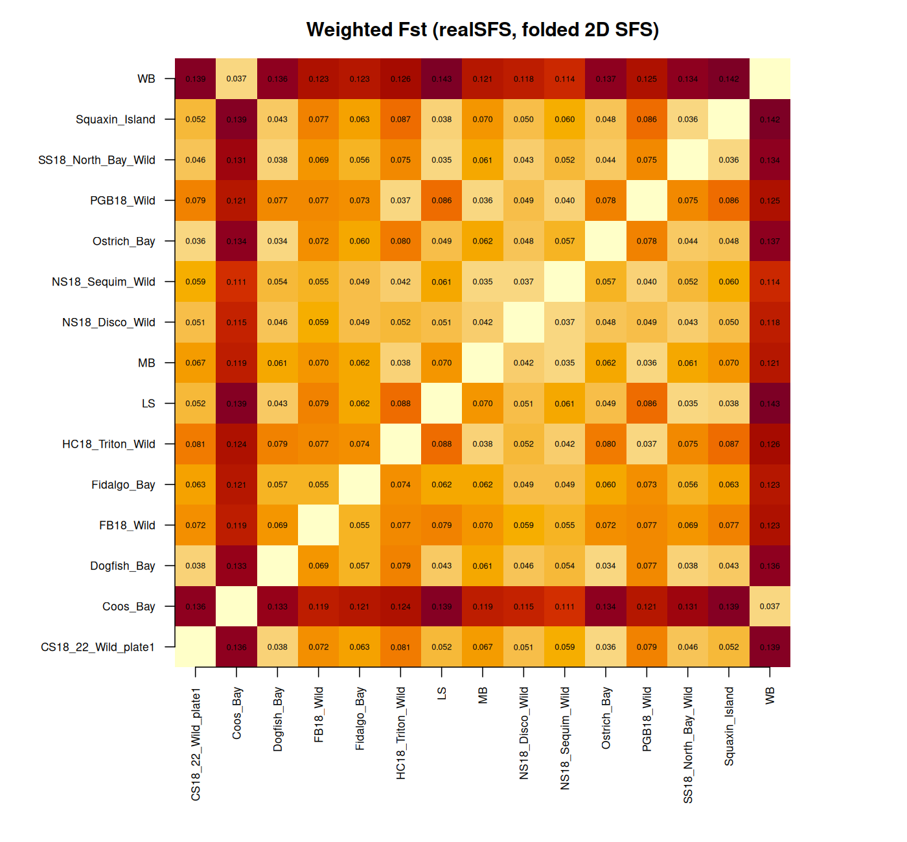

## Where this started

The [oly-lc-WGS](https://github.com/zbengt/oly-lc-WGS) repo holds low-coverage whole genome sequencing for 112 Olympia oysters (*Ostrea lurida*) from 15 sites: 13 around Puget Sound plus Coos Bay, Oregon, and a set labelled WB. Two blanks. Reads had been aligned to Olurida_v081 last November and there was a PCA in the README, but it rested on 7,865 SNPs from a single contig, so nothing about structure had really been asked yet.

Two other things had happened since. Scrubbed storage on klone had purged everything large: raw reads, BAMs, VCFs, the genome. And on September 21 NCBI released a chromosome-level *O. lurida* assembly from USDA-ARS and PSRF, GCA_061535525.1 (xbOstLuri2): 10 chromosomes, 1.03 Gb, scaffold N50 of 100 Mb, against 466,560 scaffolds and a 12.9 kb N50 for v081.

So the order of work over two days was: restore, re-align, then do the population genetics properly.

## Restore

Everything was on gannet under `bu-github/oly-lc-WGS/`, readable over https. SLURM jobs on `coenv/cpu-g2` pulled it back with six parallel `wget -c` streams, verified by size against the server:

| set                             | files | size   |
|---------------------------------|-------|--------|
| step 01 BAMs and indices (v081) | 224   | 554 GB |
| joint VCFs, PLINK, PCA, IBS     | 23    | 52 GB  |
| raw FASTQs                      | 224   | 490 GB |
| v081 reference and BWA index    | 8     | 3.2 GB |

Zero mismatches, all 112 BAMs pass `samtools quickcheck`. About three hours. The new genome came from NCBI Datasets with its md5 checked.

## Step 05: re-alignment to xbOstLuri2

`code/05_realign_xbOstLuri2.Rmd` runs a 112-task SLURM array, 24 at a time, 16 cores each: `bwa mem` with a proper `@RG`, then `samtools fixmate | sort | markdup`, then `flagstat` and `coverage` per sample. Tools from the lab R4.4 container. Duplicates are marked, not removed; the v081 run never marked them. About 41 to 78 minutes per sample, five hours end to end, no failures.

| 110 non-blank samples        | Olurida_v081 |    xbOstLuri2 |
|------------------------------|-------------:|--------------:|
| median depth                 |        5.55x |         7.15x |
| primary reads mapped         |              | 96.5 to 99.0% |
| properly paired (Coos_Bay_7) |          66% |           86% |
| duplicates                   |   not marked | 12.5 to 21.6% |
| mean MAPQ                    |           53 |            37 |

Every sample gained depth, median ratio 1.28. The MAPQ drop looked alarming until I split it out: the fraction of reads at MAPQ ≥ 30 is identical on both genomes (67% in Coos_Bay_7). What changed is that reads v081 placed with low but nonzero confidence among its fragments are now MAPQ 0 on repeat copies that are actually assembled. Any downstream filter at MAPQ 20 keeps the same reads and gains 39% more covered genome.

`HC18_Triton_Wild_10` is the one bad library: 0.78x, 79% mapped. It's out of everything below.

The BAMs went back to gannet with `bu.sh`, 552 GB in 80 minutes.

## Step 06: structure from genotype likelihoods

At 7x, called genotypes are biased toward homozygotes, so `code/06_angsd_structure.Rmd` stays in likelihood space. 109 samples, 10 chromosomes (995 of 1,029 Mb), MAPQ and base quality ≥ 20, unique proper pairs, duplicates dropped, site covered in ≥ 80% of samples, total depth between a third and twice the expected 769x.

-   ANGSD `-GL 1 -doGlf 2`, SNP p \< 1e-6, MAF ≥ 0.05, in 44 windows of 25 Mb: **7,418,858 SNPs**.
-   PCAngsd for the covariance matrix and admixture at K = 2 to 6.
-   ANGSD `-doSaf` per site per population, folded SFS with `realSFS`, Watterson's theta, pi and Tajima's D with `thetaStat`.
-   `realSFS fst` for all 105 pairs, weighted Fst.

### PCA

PC1 (5.4%) is Coos Bay and WB, together, against everything in Puget Sound. PC2 (3.4%) pulls Hood Canal (Triton Cove, Port Gamble) and most of MB away from the South and Central Sound. PC3 is the two Fidalgo Bay sets. PC4 splits the Kitsap sites (Dogfish, Ostrich, CS18) from the South Sound proper (LS, Squaxin, North Bay).

### Admixture

K = 2 is Coos Bay + WB versus Puget Sound. K = 3 separates Hood Canal from the South/Central Sound. K = 4 adds a component shared by Hood Canal and the north Olympic Peninsula sites, so Sequim and Discovery Bay come out as mixtures. The Fidalgo sets carry a visible slice of the Coos Bay component, which fits the outplanting history there.

### Fst

Weighted Fst, all 105 pairs, range 0.034 to 0.143:

-   **WB to Coos Bay: 0.037.** That is the same as between neighbouring sites within Puget Sound (0.034 to 0.038). WB to every Puget Sound site: 0.11 to 0.14. WB is Coos Bay stock. Whatever the prefix denotes, these are not a San Juan Island wild population.
-   **Three Puget Sound groups**: South/Central Sound, Hood Canal, north Olympic Peninsula. Within-group 0.034 to 0.038, between groups 0.04 to 0.09. Fidalgo Bay intermediate.
-   **MB belongs with Hood Canal**: 0.035 to Sequim, 0.036 to Port Gamble, 0.06 to 0.07 to the South Sound sites. The "Mud Bay, Eld Inlet" reading of that prefix, and the NOAA station it was matched to in step 04, need revisiting against the collection sheet.

### Diversity, with a caveat

Pi is 0.0034 to 0.0040 per site everywhere, over roughly 620 million filtered sites per population. Tajima's D is the odd one: the "2018 Wild" sets come out near zero or negative (Triton Cove −0.37) and every other set comes out at +0.35 to +0.49. That split follows the sample-naming convention exactly, and the same two groups differed in duplicate rate in step 05 (12 to 16% versus 20 to 22%), so I read it as two library batches with different error profiles in the rare-variant tail, not biology. The PCA has no batch axis: CS18, a 2018 set, clusters with the non-2018 Kitsap sites.

## Compute notes

Things that cost time and are now written into the Rmd prose:

-   `realSFS` holds every site's likelihood vectors for both populations in memory for a 2D SFS, about 140 bytes per site, so 90 GB per pair genome-wide. It was OOM-killed at 16 GB. Estimating it in 100 M-site blocks fit in memory but ran at one EM iteration per minute per block, about 12 hours per pair. The version that shipped estimates the 2D prior from chromosome 1 with a 60-iteration cap, about 50 minutes per pair, and still uses every site for the per-site Fst.
-   PCAngsd admixture on 7.4 M sites takes 20 minutes at K = 3 and nearly 3 hours per K from K = 4 up. K = 5 and 6 ran as separate jobs.
-   The whole of step 06 was 245 hours of summed task wall time, about 14 hours on the clock.

## Next

Confirm what WB and MB actually are from the collection records. Add a batch covariate before trusting Tajima's D. LD-prune before the PCA and run NGSadmix with cross-validation to settle K. And the environmental layer in step 04 needs redoing for MB once its site is fixed.
