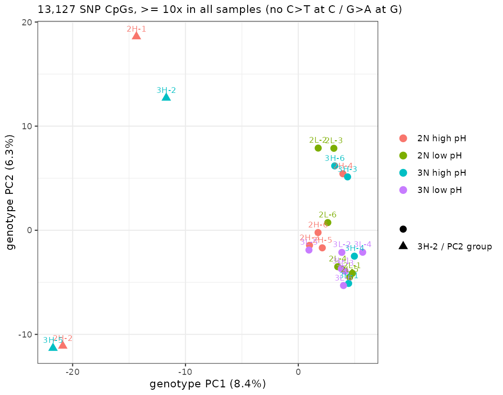
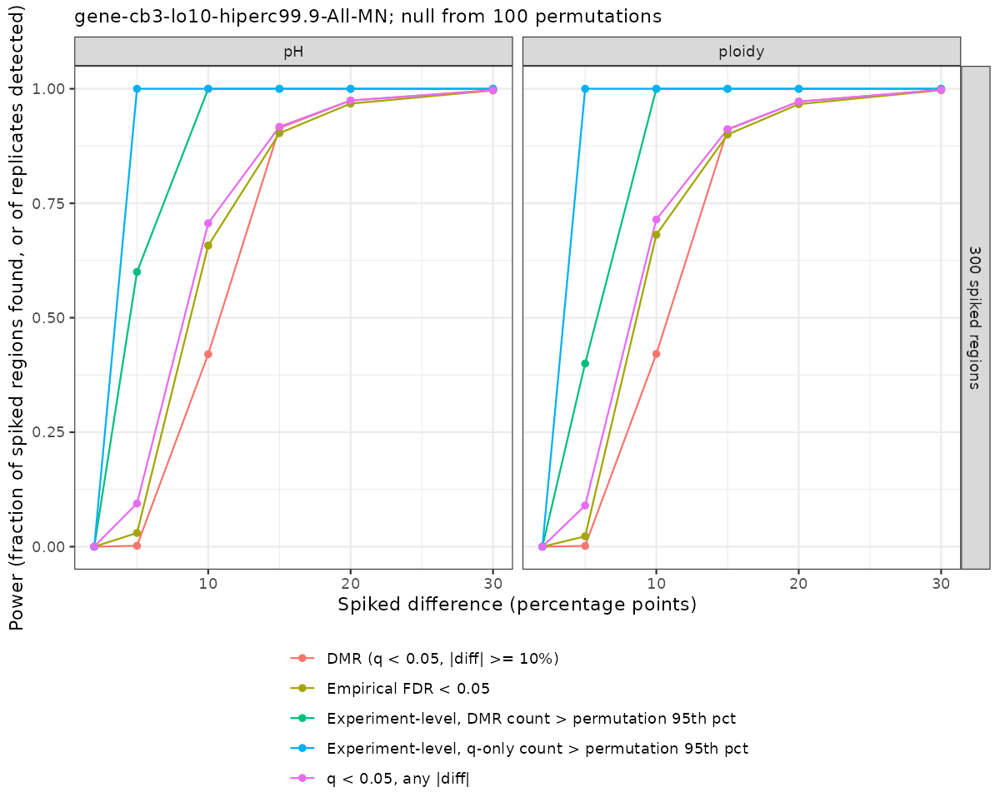
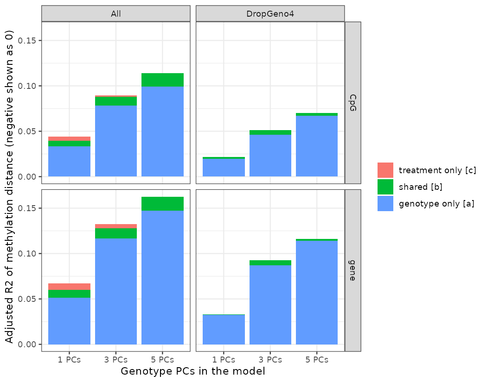

## Why

Haws diploid and triploid *C. gigas*, high vs. low pH, 6 oysters per ploidy × pH cell (24 total, WGBS). Earlier passes (04-methylKit, 04-DSS) reported 178 ploidy / 154 pH DML. Today was about finding out whether any of that holds up. Everything is in [project-oyster-oa](https://github.com/RobertsLab/project-oyster-oa) under `code/Haws/04.*`, with a running summary in `04-methylation-summary.md`.

## The answer

**No ploidy or pH effect I can detect**, at any scale: single CpGs, 250 bp or 1 kb windows, gene bodies, or GO gene sets. What does stand out is that **methylation tracks each oyster's genetic background**.

## What was run

-   **04.2 / 04.3 methylKit per-CpG.** Fixed `filterByCoverage` argument names and the outlier handling; Slurm version comparing overdispersion settings.
-   **04.4 DSS per-CpG.** New pipeline with the ploidy × pH model, sample QC, 100 label permutations, a BS-SNPer SNP check, a genotype PC covariate, and runs with outlier oysters dropped.
-   **04.6 methylKit regions.** 250 bp and 1 kb windows, gene bodies, GSEA on NCBI GO terms (2,196 sets), all against label permutations.
-   **Power simulations** (04.4 and 04.6). Known differences spiked into the real counts.
-   **04.7 variance partitioning.** Genotype vs. ploidy and pH.

## Overdispersion decides everything

Without overdispersion (methylKit `none`) there are thousands of hits: 730–6,896 per-CpG DML and 4,500–9,000 DMRs. With `MN` there are about 0. The `none` hits are differences between individual oysters, not treatment.

## Shuffled labels give as many hits as the real ones

-   DSS: 187 ploidy DML from the real labels vs. a mean of 223 from 100 shuffles. pH: 185 vs. 166.
-   methylKit regions: in all 72 comparisons (region set × test × threshold) the real count is inside the permutation distribution, usually near the median.
-   Even with `MN`, methylKit BH q \< 0.05 flags 27–185 windows in *every* shuffle. Nominal FDR from both tools is too optimistic for this data. Only the permutations give a fair null.

The one GO lead (*mitotic spindle assembly checkpoint signaling*, pH, FDR 0.078) is something about half of the shuffled labelings also produce.

So the earlier 178 / 154 DML, and the annotation and enrichment built on them (07–09), are most likely false positives.

## Genotype is the one clear result

All 24 samples pass technical QC (conversion 99.5%, mapping 60–62%). But genetic similarity between pairs of oysters predicts their methylation similarity (rho = 0.86), using only SNPs bisulfite conversion can't fake.

Four oysters are genetically distinct (2H-1, 2H-2, 3H-5, 3H-2), and **all four are high pH**. That happens by chance about 5% of the time, so pH is partly confounded with genotype.

Accounting for it doesn't uncover a hidden effect. Dropping the outliers three different ways, and a permutation that keeps the four in high pH (`fixGeno4`), all give counts within the null. A 9-gene pH lead in one drop set disappeared when all four were removed.

## How big an effect could we have seen?

Spiked known Δ into the real data (binomial thinning, real labels, 10 replicates per Δ) and asked when the result would beat the permutation null.

| Test | Experiment-level detection limit |
|----|----|
| Single CpGs (DSS, 1,000 spiked) | \~20 points |
| 1 kb windows (methylKit `MN`, 1,000 spiked) | \~10 points |
| Gene bodies (methylKit `MN`, 300 spiked) | \~5 points |

Gene bodies are the most sensitive test. The real null rules out gene-body shifts of about 5 points or more across \~1% of genes. Shifts of \~2 points can't be seen. These are best cases, since effects are uniform within a group.

## Variance partitioning

Distance-based variance partitioning and PERMANOVA on methylation distance, with 3 genotype PCs, ploidy and pH as terms (`vegan`).

-   **Genotype** explains 8–12% of methylation distance between oysters (Mantel r = 0.73–0.77). Without the four outliers it's still 5–9% (r = 0.28–0.41, p \< 0.001).
-   **Ploidy and pH** explain −0.5% to 0.4%. pH is never significant in PERMANOVA. Ploidy is borderline with all 24 (p = 0.02–0.05) and gone without the outliers.
-   Per feature, 4–5× more CpGs and genes are genotype-associated than chance (2× without the outliers). Treatment sits at its shuffle null.
-   85–95% is unexplained by either.

## Next

-   Pull the hatchery records for the four genetic outliers. If they share a source or family, the pH arm has a design confound to report.
-   Flag or retract the older DML and the 07–09 annotation built on them. The 07 TE overlaps also used the wrong file.
-   Write it up as a solid null with a positive genetics result. Run the exon, intron, upstream and TE region sets once against permutations to close out the region analysis.
-   The genotype–methylation link (cis-mQTL-like? family?) could seed a follow-up. `per-gene-partition-*.csv` is the starting point.
