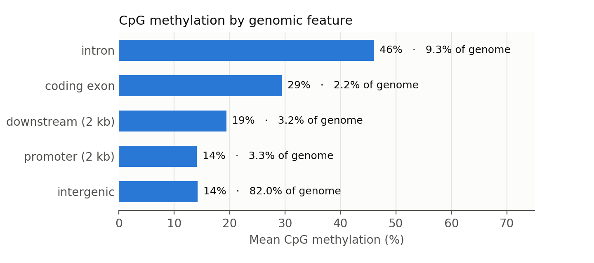
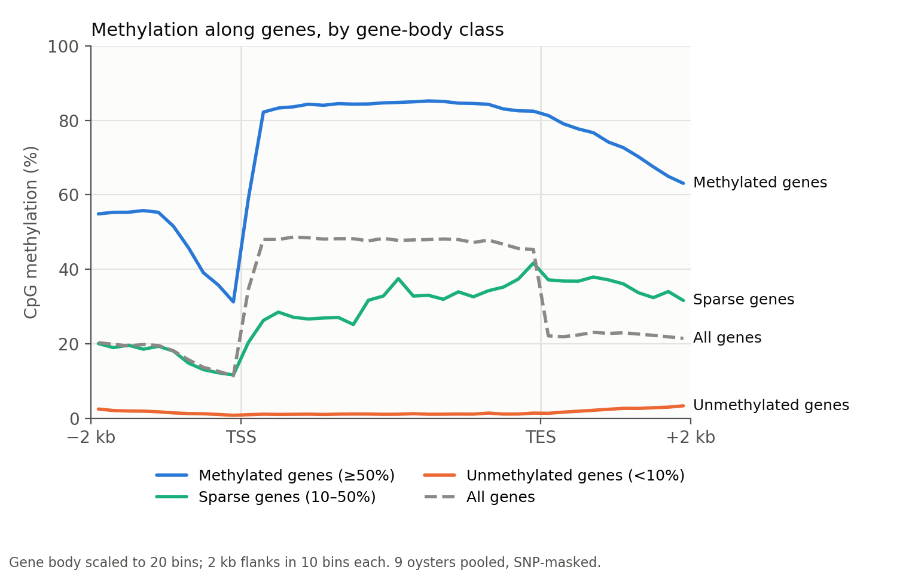
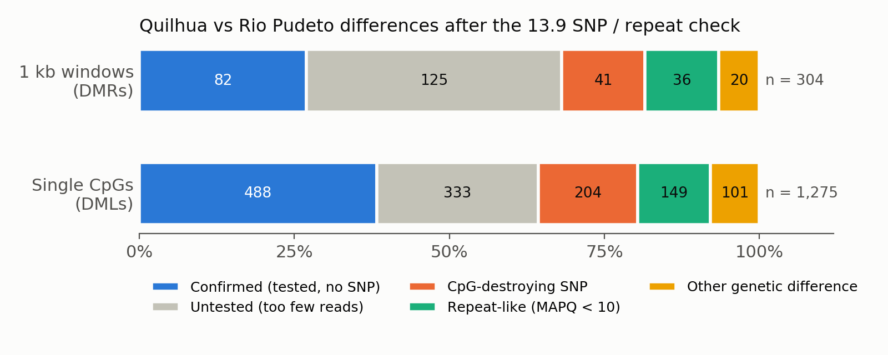
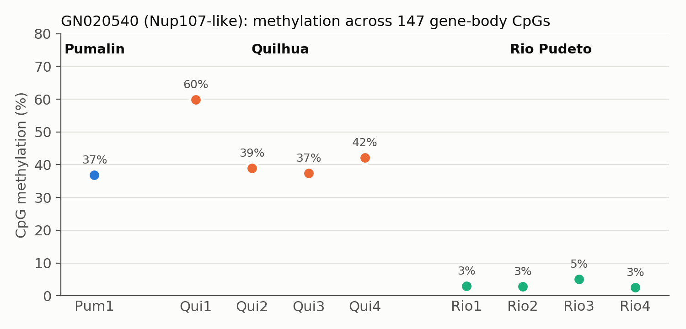
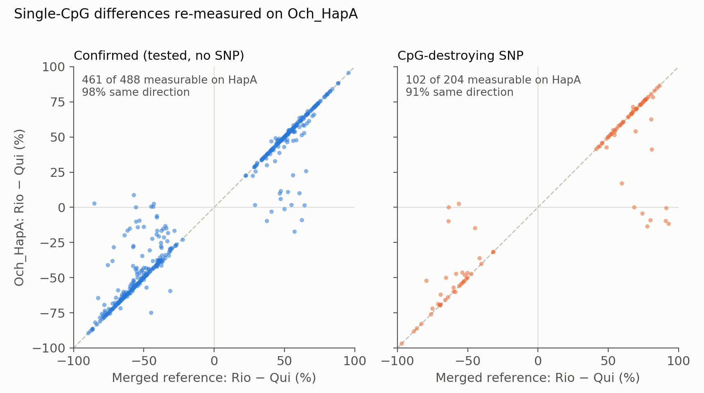

## Where this started

Whole genome bisulfite sequencing (WGBS) for *Ostrea chilensis* came in on October 8: 15 paired-end files (2×151, NovaSeq X, one lane), named as 5 oysters from each of three sites in southern Chile: Pumalin (PUM), Quilhua (Qui) and Rio Pudeto (RP). These are the same three sites as the ONT RNA-seq in [project-ostrea-chil](https://github.com/RobertsLab/project-ostrea-chil). The plan was simple: align, call methylation, compare populations.

Everything is on the `wgbs-methylation-pipeline` branch, [PR #2](https://github.com/RobertsLab/project-ostrea-chil/pull/2), as the `13.x` series.

## Reference

Same reference as the RNA-seq (`09`), so gene IDs line up: `merged_out.fasta` with `GN.gene.gff3`, from gannet. It's 1.18 Gb in 10 chromosome-scale sequences, one per chromosome. Four are labelled A (2A, 4A, 6A, 10A) and six B (1B, 5B, 6B, 7B, 8B, 9B), from 41 Mb (`10A`) to 232 Mb (`1B`). It's the same sequence as "Assembly 1.0" in `12-compare-genomes`. Och_HapA covers 68% of it and Och_HapB 84%, so it isn't either haplotype assembly. The annotation has 21,444 genes.

## Pipeline

All on klone, `coenv/cpu-g2`, 5 samples at a time, using the `myflow` conda env (Bismark 0.25.1, bowtie2, fastp 1.0.1, samtools 1.22):

-   **13.1:** download the genome and annotation, build the Bismark index (10 minutes).
-   **13.2:** one SLURM array task per sample: `fastp` (10 bp 5′ trim) → Bismark (`--score_min L,0,-0.6`, directional) → `deduplicate_bismark` → `bismark_methylation_extractor` → strand-merged CpG coverage → sorted BAM.
-   **13.3:** Bismark, MultiQC and a one-line-per-sample summary.

I ran Pum1 alone first. That caught three problems: the relocated conda env's `curl` pointed at a certificate path that no longer exists; Bismark refuses `--basename` with `--parallel`; and a second copy of the test job, from another session, ran into the same folder. The Pum1 M-bias was flat for R1 after the 10 bp trim, but R2 was still high at its first 5 bases (29% falling to 20%). So extraction now uses `--ignore_r2 5`, and each sample takes a lock so two jobs can't run on it at once. After that, all 15 ran in 1 h 23 min to 2 h 12 min each.

|                                    | range across samples |
|------------------------------------|----------------------|
| read pairs after trimming          | 22.4 to 41.5 M       |
| mapping                            | 56.0 to 58.5%        |
| duplicates                         | 3.5 to 7.1%          |
| CpG methylation                    | 18.9 to 21.6%        |
| CHH methylation (conversion check) | 0.6 to 0.8%          |

Median coverage per CpG is 4 to 5×, which shapes everything below. 31% of read pairs mapped to more than one place.

## Fifteen files, nine libraries

The QC table was too tidy. Pum1, Pum2, Pum3 and Pum5 all mapped at 56.0% with 19.4% CpG methylation, and Rio3 and Rio5 were identical in every column, down to the read-pair count (32,773,197).

The index barcodes in the read headers explain it. The 15 files contain 9 barcodes. Checking read names (the first 200,000 of each file, searched across the other file; controls between different barcodes share 0%):

| file             | reads found in | what it is                               |
|------------------|----------------|------------------------------------------|
| PUM2, PUM3, PUM5 | PUM1, 100%     | subsets of PUM1                          |
| PUM4             | PUM5 + Qui1    | a mixture: all of PUM5 plus part of Qui1 |
| Qui5             | Qui1, 100%     | subset of Qui1                           |
| RP5              | RP3, 100%      | full copy, same count                    |

PUM4 needed a full check: its first 200,000 reads all come from Qui1, but the rest of the file doesn't. Across all 30,650,313 reads, 74.3% carry the Pumalin index (`TGAGTACT`) and 25.7% the Qui1 index (`CTGTCACT`). By read name, PUM4 is every one of PUM5's 22,785,307 reads plus 7,865,006 reads from Qui1 (20% of that file), and nothing else.

The copies are pair-aware random subsamples in shuffled order, untrimmed 151 bp, with R1/R2 pairing intact. Each source file starts at tile 1101 and each copy starts mid-run. That looks like a downsampling or placeholder step pointed at the wrong input, not sequencing or demultiplexing. I've asked the provider for the original per-sample files.

That leaves **Pum1, Qui1–4 and Rio1–4**. Pumalin has n = 1, so the only comparison is **Quilhua vs Rio Pudeto, 4 vs 4**.

## The methylome as a whole

Before comparing populations I wanted a picture of the shared methylome. `13.6` (`code/13.6-wgbs-methylation-landscape.Rmd`) pools read counts across all 9 oysters at each CpG, SNP-masked with the `13.7` calls. That gets per-CpG depth well above what any one oyster has.

**Global level.** Per oyster, CpG methylation is 18.9–21.6%, with no real difference among sites. Of the 14.4 M CpGs that pass filters (55% of the 26.1 M in the assembly), 18% are methylated (≥ 50%), 78% are unmethylated (\< 10%), and only 4% are in between. A classic mosaic invertebrate methylome.

**Where it is.** Methylation is concentrated in gene bodies. Introns are the most methylated compartment, with methylated CpGs 5.6× enriched there; coding exons are 2.1×. Intergenic sequence, 82% of the genome, is depleted (0.32×). The GFF has no UTRs, so "exon" here means coding exon. Along chromosomes, methylation in 100 kb windows tracks gene density (Spearman ρ = 0.37).

**Gene bodies.** Of the 13,640 genes with enough coverage, 35% are methylated and 59% unmethylated, two clear groups. Methylated genes are CpG-depleted (gene methylation vs CpG o/e, ρ = −0.59), the signature of long-term germline methylation. In methylated genes, methylation jumps from about 31% just upstream of the TSS to about 85% across the body. It also climbs from 5′ to 3′: first exon 18%, sixth and later exons 56%; first intron 37%, later introns 61%. Gene-body levels are very stable between animals (mean SD across oysters, 2.6 percentage points).

**Function.** Genes with a Swiss-Prot hit and GO terms have median gene-body methylation of 67%; genes with no hit sit at 0.8%. 321 of 839 GO BP terms differ (Wilcoxon, FDR \< 0.05). The most methylated are housekeeping: mRNA splicing, chromatin remodeling, translation, rRNA processing, ER-to-Golgi transport and protein degradation (medians 82–90%). The least methylated are responsive or tissue-specific: cholinergic synaptic transmission, ion and calcium transport, acetylcholine receptor signaling (medians about 0.6%). Broad groups split the same way: RNA processing, translation, cell cycle and mitochondria at 82–86%, against immune/defense (1.2%), signal transduction (14%) and development (27%). Stress response (67%) isn't different from background.

So this is the textbook invertebrate pattern: methylation in the bodies of conserved, constitutively expressed genes, and little in inducible ones. Caveats: Swiss-Prot hits cover only 46% of genes, GO terms are direct annotations (not propagated), and with one Pumalin oyster the pooling is uneven across sites.

## Quilhua vs Rio Pudeto

`13.4` (methylKit, in the lab R4.4 container) with CpGs at ≥ 5× in at least 3 of 4 oysters per population. Before testing it drops CpGs that carry a SNP from `13.7`, which calls SNPs genome-wide from the bisulfite BAMs with `biscuit`: 952,169 SNPs at QUAL ≥ 20, 31,673 of them at CpGs.

-   Global methylation is the same in both: 20.1% Quilhua, 20.5% Rio.
-   1,275 single CpGs (DMLs) and 304 1 kb windows (DMRs) differ by ≥ 20% (q \< 0.01), mostly intergenic.
-   Gene-body methylation (limma on M-values): 1 of 7,247 genes, **GN020540**.

## How much of that is genetic?

A C→T SNP at a CpG reads exactly like an unmethylated C, and at 5× the genome-wide calls miss a lot. So `13.9` re-checks each DML and DMR. It splits each oyster's reads by Bismark strand and counts a base only from the strand where bisulfite can't change it. At a CpG C, bottom-strand reads report the genotype. It pools reads by population, needs ≥ 8 reads per side and ≥ 2 carrier oysters to call a variant differentiated, and flags windows where most reads have MAPQ \< 10. A region is **untested** when fewer than half its CpGs have enough reads to see a SNP.

| class                      | DMR windows | single CpGs |
|----------------------------|------------:|------------:|
| confirmed (tested, no SNP) |          82 |         488 |
| untested                   |         125 |         333 |
| CpG-destroying SNP         |          41 |         204 |
| repeat-like                |          36 |         149 |
| other genetic difference   |          20 |         101 |

The CpG-destroying ones are artefacts. In all 204 DMLs and 36 of 41 windows, the population carrying the SNP is the one that looks less methylated. These survived the `13.7` mask; pooling reads by population is what finds them. Of the confirmed set, the single CpGs are 400 intergenic, 65 intron, 20 promoter and 3 exon.

## GN020540

The one differentially methylated gene. It's on `Chromosome_9B`, 6.5 kb, 4 exons, and its best Swiss-Prot hit is Nup107, a nuclear pore protein (54% identity, but the predicted protein is only 168 aa against 926, so probably a partial model). Quilhua is 37 to 60% methylated across its 147 CpGs, Rio is 3 to 5%, and Pum1 looks like Quilhua. 80 of the CpGs have enough reads to test for SNPs, none are differentiated, and depth is the same in both populations. So the CpGs are there in Rio; they just aren't methylated. A third of its reads are MAPQ \< 10, which is worth keeping in mind.

The RNA-seq from `09` (different animals) has it at 0 to 33 CPM, with half the libraries at exactly 0. That's too thin to say anything about expression.

## GO

`13.8` tested GO enrichment for genes with a DMR in the body or 2 kb promoter: 47 genes against 6,219. Nothing passes FDR. The top terms (lysosome localization, filopodium assembly, amino acid catabolism) rest on 2 or 3 genes each, mostly on untested windows. Only 8 of the 47 genes sit on confirmed windows, which is too few for enrichment.

## HapA check

The merged reference turned out to be HapA's chromosomes 2A, 4A, 6A and 10A, identical down to the base, plus six chromosomes from HapB. So I re-ran the whole chain on Och_HapA alone (`WGBS_REF=hapa bash code/13-wgbs-submit.sh`, same 9 oysters, same settings) and compared the two with `13.10`.

| mean per oyster                      | merged | Och_HapA |
|--------------------------------------|-------:|---------:|
| mapping (unique)                     |  57.4% |    67.4% |
| pairs mapping to more than one place |  31.9% |    15.8% |
| CpGs ≥ 5×                            | 7.86 M |   9.13 M |

Half the multi-mapping goes away. Reads that were split between near-duplicate A and B sequences now have one home. On the four chromosomes identical in both references, depth goes up 6% and per-CpG methylation doesn't move: r = 0.995 and a mean difference of 0.7 percentage points in every oyster.

To re-test the population differences, `13.10` lifts every DMR window, every DML CpG (±100 bp) and GN020540 onto HapA with `minimap2`. It then re-measures Rio − Quilhua the same way on both references, from reads pooled per population.

| 13.9 class | DMR windows: same direction / ≥ 10% on HapA | single CpGs: same direction / ≥ 20% on HapA |
|----|----|----|
| confirmed (tested, no SNP) | 96% / 94% (80 of 82 measurable) | 98% / 92% (461 of 488) |
| untested | 97% / 91% | 98% / 93% |
| CpG-destroying SNP | 70% / 57% | 91% / 88% (102 of 204) |
| repeat-like | 94% / 78% | 93% / 77% |

The confirmed set holds. The CpG-destroying sites "replicate" too, and that's expected rather than reassuring: the SNP is in the oysters' DNA, so it makes the same false difference on any reference. Swapping references tests mapping, not genotype; that job is `13.9`'s. 129 of the single CpGs land where HapA has no CpG at all, so those sites exist only on the HapB chromosome.

**GN020540** maps to `Chromosome_9A:61,735,450–61,741,949` at 100% identity across the gene. Quilhua is 34–61% methylated and Rio 2.7–4.5%, within 1.7 points of the merged values in every oyster.

The genome-wide picture doesn't change either. With genes lifted onto HapA by Liftoff (`13.11`, 17,889 of 21,444) and a HapA SNP mask (1.55 M SNPs, 51.5 k at CpGs; on the four shared chromosomes it recovers 95% of the merged calls, 554,890 of 582,123), `13.6` on HapA passes 89% of assembly CpGs against 55% on the merged reference. Mean methylation is 20.6% (merged 20.2%), and 35% of genes are methylated and 60% unmethylated. For the 12,010 genes estimated on both, gene-body methylation agrees closely (Spearman ρ = 0.963, median difference 0.07 points, 97.2% in the same class), and the GO picture has the same top terms at both ends.

So HapA is the better reference for this data: more reads placed, half the ambiguity, and the same biology. The cost is the 3,555 genes that didn't lift onto HapA.

### Calling the differences again on HapA

Re-measuring the merged calls is one test. The stricter one is to call them from scratch: `13.4` on the HapA alignment, with the lifted genes and the HapA SNP mask, then `13.9` on its windows.

| Quilhua vs Rio Pudeto           | merged | Och_HapA |
|---------------------------------|-------:|---------:|
| DMR windows                     |    304 |      379 |
| single CpGs (DMLs)              |  1,275 |    1,455 |
| genes tested (gene body)        |  7,247 |    9,457 |
| differentially methylated genes |      1 |        2 |

More coverage means more windows and genes clear the filters. Of the 289 merged windows that lift to HapA, 160 are called again independently, 158 of them in the same direction, and 218 HapA windows are new.

The `13.9` classes look much the same as before:

| class                      | merged (304) | Och_HapA (379) |
|----------------------------|-------------:|---------------:|
| confirmed (tested, no SNP) |           82 |             99 |
| untested                   |          125 |            133 |
| CpG-destroying SNP         |           41 |             70 |
| repeat-like                |           36 |             57 |
| other genetic difference   |           20 |             20 |

The 99 confirmed HapA windows split 57 higher in Rio and 42 higher in Quilhua. They touch the body or 2 kb promoter of 14 genes. Four of those were also among the 8 genes with confirmed windows on the merged reference: GN020540, GN017845 (farnesyltransferase β), GN007260 (NCF-2) and GN012742 (HELZ2).

The second differentially methylated gene on HapA, **GN016259** (RNA-binding protein 25, a splicing factor), is −20% in Rio (adjusted p = 0.040). It doesn't hold up. No `13.4` window covers it, so I ran `13.9` on the gene ± 2 kb. It has 9 variants that differ between the populations, and 4 of them destroy a CpG (C\>T at a C, or G\>A at a G). All 4 are at 60–83% in Rio and 0–20% in Quilhua, in the population that looks less methylated (Rio 63–77% against Quilhua 86–92%). That's the SNP signature.

**GN020540** comes through as the top gene again on HapA (−34.3%, against −35.0% merged). It has no differentiated variant across 82 testable CpGs. A third of the reads at this gene are MAPQ \< 10 on both references (2,410 of 7,308 on HapA, 2,344 of 7,019 merged), concentrated in the middle of the gene. So it's a property of the gene, perhaps a repeated or duplicated stretch inside it, not of the reference. Both references call six windows over the gene, all lower in Rio (−25 to −72%). The well-mapped ends are confirmed or untested, and the middle windows (48–66% MAPQ \< 10) are repeat-like: 2 of 6 merged, 3 of 6 on HapA. It deserves a closer look.

## Next

Use HapA as the primary reference from here. Work out what the low-MAPQ reads at GN020540 are, from relative depth and where the secondary hits fall. Then the corrected Pumalin, Qui5 and Rio5 files when they arrive, and a rank-based GO across all genes using the gene-body statistics instead of a cut list.
