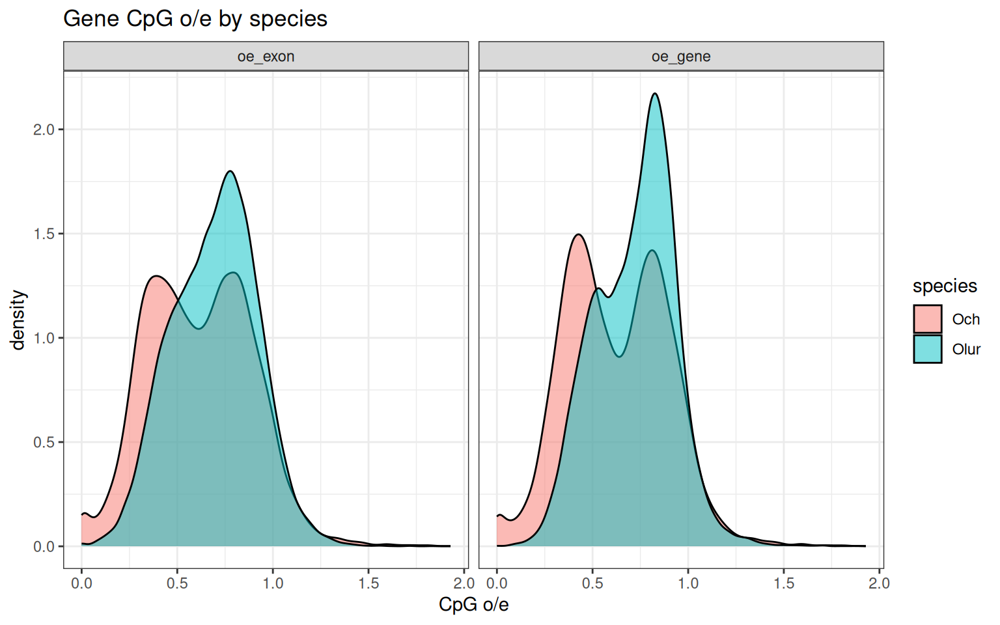
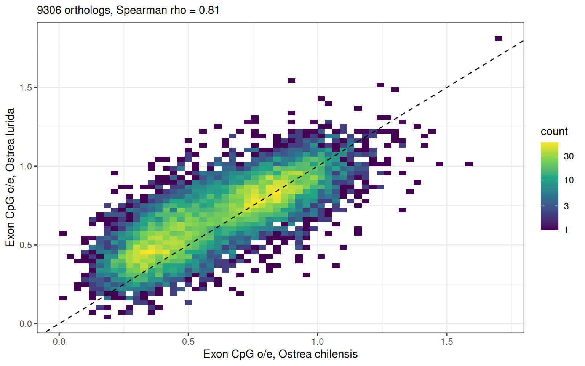
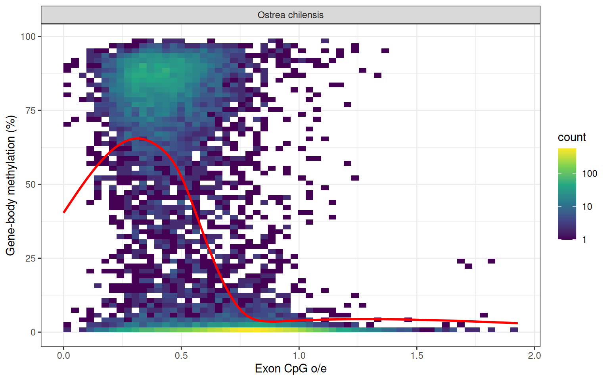
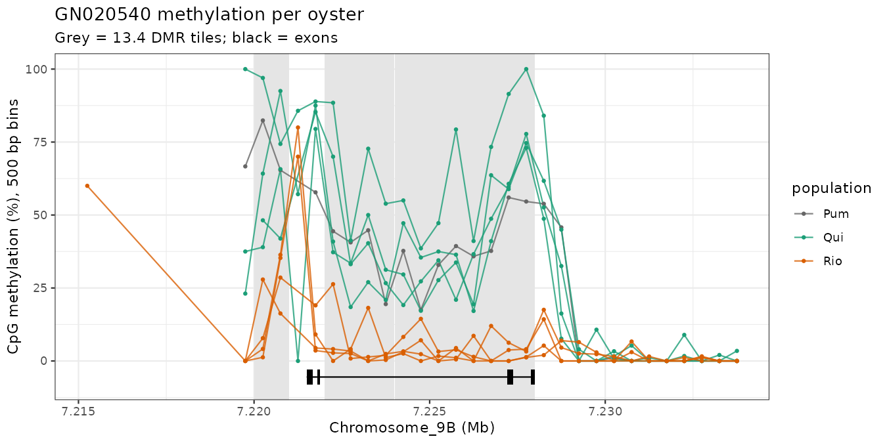

## Where this started

The *Ostrea chilensis* WGBS write-up is in post 94: 15 files that turned out to be 9 libraries, the Quilhua vs Rio Pudeto comparison, and GN020540 as the one gene that differs. This post picks up two threads from there. First, how does *O. chilensis* methylation compare with *O. lurida*? Second, what is actually going on at GN020540?

Code is in [project-ostrea-chil](https://github.com/RobertsLab/project-ostrea-chil), [PR #3](https://github.com/RobertsLab/project-ostrea-chil/pull/3), on top of the `wgbs-methylation-pipeline` branch:

-   `14.1-meth-compare-orthologs.sh`: one-to-one orthologs
-   `14.2-meth-compare.Rmd`: the cross-species comparison
-   `15-GN020540-locus.Rmd`: the GN020540 locus

## *O. chilensis* vs *O. lurida*

### Inputs

There's no *O. lurida* methylation data in this run yet, so on that side the comparison uses genomic CpG o/e. Germline methylation slowly turns methylated CpGs into TpGs, so genes that have been methylated for a long time are CpG-depleted (low o/e).

-   *O. chilensis*: `merged_out.fasta` + `GN.gene.gff3` (21,444 genes), and the 9 clean WGBS oysters pooled.
-   *O. lurida*: `Olurida_v081` with the MAKER gene models from the genomic databank (`Olurida_v081_genome_snap02.all.renamed.putative_function.domain_added.gff`). That file is 3.1 GB because it carries all the evidence alignments and the genome, so I kept only the `maker` gene/mRNA/exon/CDS/UTR rows: 32,210 genes. No *O. lurida* assembly on NCBI, including the chromosome-level xbOstLuri2, has an annotation.

Orthologs are reciprocal best DIAMOND `blastp` hits on the longest protein per gene: **9,306 one-to-one pairs**, mean identity 79.5%. Only 3,337 pairs align over ≥ 80% of both proteins. v081 is in 159,429 contigs, so many *O. lurida* models are partial.

### CpG o/e

Both species are bimodal. *O. chilensis* has more genes in the low (methylated) peak: median exon o/e 0.61 vs 0.71 for *O. lurida*.

Across orthologs, CpG o/e lines up closely: Spearman ρ = 0.81 for exons (0.83 for pairs ≥ 70% identical), 0.74 for whole gene bodies.

### Measured methylation in *O. chilensis*

Pooling the 9 oysters, 18.1% of 14.7 M CpGs are methylated (≥ 50%). Introns are the most methylated (50% of CpGs), then exons (31%), with promoters and intergenic at 14 to 15%.

Of 13,740 genes with enough coverage, 5,423 (39%) are methylated, at a median of 83%. Methylated genes have exon CpG o/e of 0.42 against 0.78 for unmethylated genes (ρ = −0.58), so o/e tracks measured methylation well in this species.

### Putting them together

For 7,353 orthologs with *O. chilensis* gene-body methylation:

| *O. chilensis* gene | orthologs | *O. lurida* median exon o/e | *O. lurida* o/e \< 0.6 |
|-----------------|------------------:|------------------:|------------------:|
| methylated | 3,650 | 0.52 | 67% |
| unmethylated | 3,703 | 0.83 | 8% |

ρ = −0.61 between *O. chilensis* gene-body methylation and *O. lurida* CpG o/e. The genes carrying the long-term methylation footprint are largely the same in both species. The next step is real *O. lurida* methylation: the published MBD-BS data on v081 would slot into `data/14-Olur-meth-samples.tsv`. MBD-BS inflates absolute levels, so that comparison will lean on within-species ranks.

## GN020540

From post 94: GN020540 is 2 to 4% methylated across the gene body in all 4 Rio oysters and 36 to 61% in Quilhua and Pum1, with seven 1 kb DMRs from the promoter to the last exon. Its Swiss-Prot hit is Nup107, but the predicted protein is 168 aa against 926, so it's a fragment. No other gene is within 50 kb.

### A repeat in the intron

Read depth across the intron (7,222,000 to 7,227,000) is 1.7 to 2.4× the genome mean in **every** oyster, while the flanks are about 1×. That segment, about 3.9 kb, is an interspersed repeat: 223 copies of ≥ 2 kb in HapA, 368 in HapB. It also explains why Quilhua and Pum1 sit around 30% there (Qui1 54%) rather than about 70% as at the promoter and 3′ exon: reads from a methylated copy and an unmethylated one land on the same place.

Is Rio losing methylation at this repeat family everywhere? No. Across about 300 other copies with ≥ 20 calls per oyster, mean methylation per copy is 19 to 21% in every oyster, Rio included, and about two-thirds of copies are below 10%. The Rio loss is specific to this copy.

### The haplotypes

The merged reference's `Chromosome_9B` is HapB's `Chromosome_9B`, base for base. HapA has the locus on `Chromosome_9A:61,713,445-61,742,758`, identical over 29.3 kb, including the gene and the repeat. Upstream they differ. In HapB the 20 kb before the gene is a tandem array (it aligns to itself many times); HapA has none of it, and its alignment stops 800 bp before the gene.

Depth over that array is low in everyone (0.2 to 0.6×), with nothing Rio-specific. Short bisulfite reads can't tell which version Rio carries.

### Genetics and expression

There are no QUAL ≥ 20 SNPs from `13.7` in the 19 kb around the gene; the best of the 911 candidate sites is QUAL 18. The ONT RNA-seq from `09` has only 0 to 5 reads per library at the gene, out of 200,000 to 400,000 mapped reads. That's too few to compare sites (Rio 3 to 15 per million, Quilhua 3 to 10). StringTie's zeros in half the libraries happen for 3,022 other genes too, so they come from read assignment, not silencing.

So this is a fixed, locus-specific difference with no SNP behind it. The upstream structural variant is the obvious candidate, but testing it needs long reads from Rio and Quilhua animals. ONT genomic reads would also give methylation calls directly.

## Notes

-   **PUM4.** It's a mixture: every one of PUM5's 22,785,307 reads plus 7,865,006 reads from Qui1, and nothing else (checked by read name across the whole file, and by index: 74.3% Pumalin, 25.7% Qui1). Its first 200,000 reads happen to all be Qui1, which is why it first looked like a Quilhua subset. Post 94 is updated. Either way it's out of the analysis.
-   **A plotting bug.** The lab R container has no `hexbin`, so `geom_hex()` layers were silently dropped and two `14.2` scatter plots came out empty. Fixed with `geom_bin2d()`.
-   klone compute nodes have no internet, and `--no-mount bind-paths` also drops DNS inside the container. `15` caches its gannet inputs through `15-GN020540-fetch.R`, run on a login node with `-B /etc/resolv.conf`.

## Next

-   *O. lurida* MBD-BS calls on v081 into `14.2`.
-   Long reads across GN020540 in a few Rio and Quilhua oysters.
-   Re-check the cross-species numbers once the corrected Pumalin files arrive.
