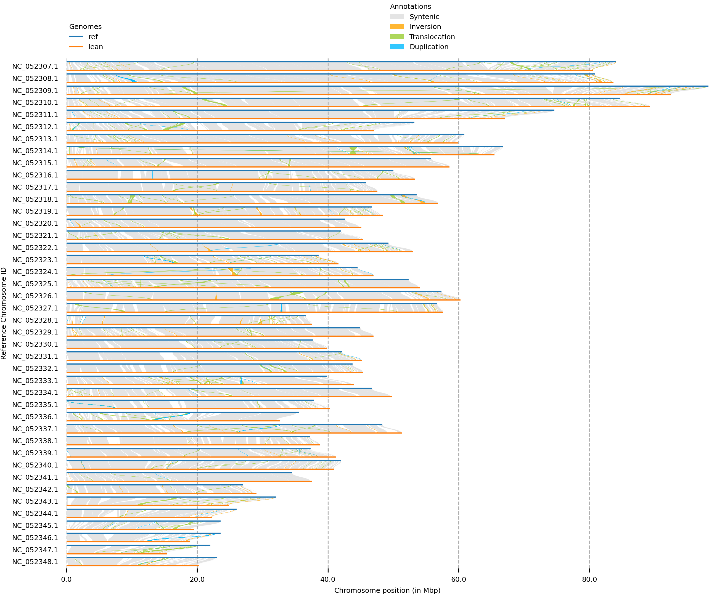

Rick asked whether we had compared our ecotype genomes to the published lean reference genome, and specifically lean to lean. We had all the pieces from the structural variant work but had never written it up as its own comparison, so here it is. The code is in [23.17](https://github.com/RobertsLab/project-lake-trout/blob/main/code/23.17-lean-reference-baseline.py) and [23.18](https://github.com/RobertsLab/project-lake-trout/blob/main/code/23.18-reciprocal-pav-exon.py), and the full write-up is the [23-lean-baseline README](https://github.com/RobertsLab/project-lake-trout/blob/main/analyses/23-lean-baseline/README.md).

## Why lean vs lean

The published reference (SaNama_1.0) comes from a single Seneca-strain lean female, a gynogenetic doubled haploid, so it is one homozygous lean haplotype. Our lean and siscowet assemblies are hifiasm primary contigs from four pooled fish each. Two lean genomes should differ only by within-lean variation and assembly artifacts. That makes the lean vs published-lean difference a baseline for judging lean vs siscowet: if a difference is just as big between two leans, it isn't telling us about ecotype.

No new alignment was needed. The SyRI runs for lean vs reference, siscowet vs reference and lean vs siscowet were already done.

## How different are two lean genomes?

|                         | lean vs ref | siscowet vs ref | lean vs siscowet |
|-------------------------|-------------|-----------------|------------------|
| SNPs                    | 1.14 M      | 1.23 M          | 1.24 M           |
| Highly diverged (Mb)    | 231         | 175             | 197              |
| Inversions (Mb)         | 9.9         | 21.3            | 29.3             |
| Translocations (Mb)     | 62.6        | 107.9           | 120.8            |
| Not aligned, query (Mb) | 230         | 380             | 491              |

At the sequence level (SNPs, indels, diverged blocks), our lean differs from the published lean about as much as it differs from siscowet. Highly diverged sequence is actually higher lean to lean. Large rearrangements are 2–3× bigger between ecotypes, but siscowet vs reference carries most of that on its own, and the siscowet assembly is larger (2.84 vs 2.58 Gb). I can't yet separate real siscowet structure from assembly differences.

## Which genome is the odd one out?

For each of the \~100,000 lean–siscowet SVs (≥ 50 bp), I asked whether our lean and our siscowet each differ from the published lean at that spot. Of the 83,552 events placed on both sides:

| class         | siscowet side | lean side | both | neither |
|---------------|---------------|-----------|------|---------|
| all           | 0.30          | 0.25      | 0.36 | 0.10    |
| indel         | 0.31          | 0.28      | 0.34 | 0.07    |
| translocation | 0.22          | 0.13      | 0.51 | 0.15    |
| duplication   | 0.33          | 0.06      | 0.32 | 0.29    |
| inversion     | 0.39          | 0.24      | 0.37 | 0.01    |

"Lean side" means siscowet matches the published lean and only our lean is different. That is a quarter of all lean–siscowet SVs (99 Mb), and none of them are lean-ecotype differences. For indels the two sides are about equal, which is what polymorphism or assembly noise looks like, not an ecotype axis. Duplications, translocations and inversions skew toward siscowet. "Both" is three times what shuffled positions give, which points to hotspots, probably repeats that are hard to assemble.

## Reciprocal PAV genes are mostly not missing genes

This was the surprise. Every reciprocal-PAV gene is a reference gene, so all of them are in the published lean genome. That includes the 71 genes absent from all four of our lean fish.

Looking closer, a reciprocal-PAV "gene" is usually a big gene (median \~56 kb) with a short absent piece, a median of 3% of its length. Only 6 of 115 are at least half absent, and 5 of those are extra Liftoff copies. Splitting the absent sequence by gene model:

|        | genes | CDS hit | non-coding exon only | intron only | CDS bp obs / exp |
|--------|-------|---------|----------------------|-------------|------------------|
| all    | 115   | 7       | 5                    | 103         | 0.46             |
| tier A | 77    | 6       | 4                    | 67          | 0.46             |

90% are intron only. Coding sequence is hit at less than half the rate random placement in the same genes would give. Three single-copy annotated genes lose real coding sequence:

-   `ttll9`: 7 of 14 exons, 56% of CDS, absent in lean fish
-   `grb10`-like: 3 of 20 exons, 18% of CDS, absent in siscowet fish
-   `gpia`: 3 of 18 exons, 12% of CDS, absent in lean fish

The rest of the coding hits are a transposon-like gene (K02A2.6-like), an extra gene copy and a 12 bp clip.

## What this changes

-   Tier A should be read as intronic structural variation inside genes, not gene presence/absence. Intronic changes could still matter for regulation.
-   The energy-metabolism story narrows to `gpia` and `grb10`-like for coding changes.
-   A lean–siscowet difference is ecotype-informative only if the published lean sides with our lean.
-   This is on top of the read-coverage filter from earlier this week. It removed 89% of the corroborated ecotype-only genes as assembly gaps, including angptl5-like and the calcium-channel enrichment from the [two-genome post](../82-trout-recip-pav/index.qmd).

The landing page is updated: <https://robertslab.github.io/project-lake-trout/>
