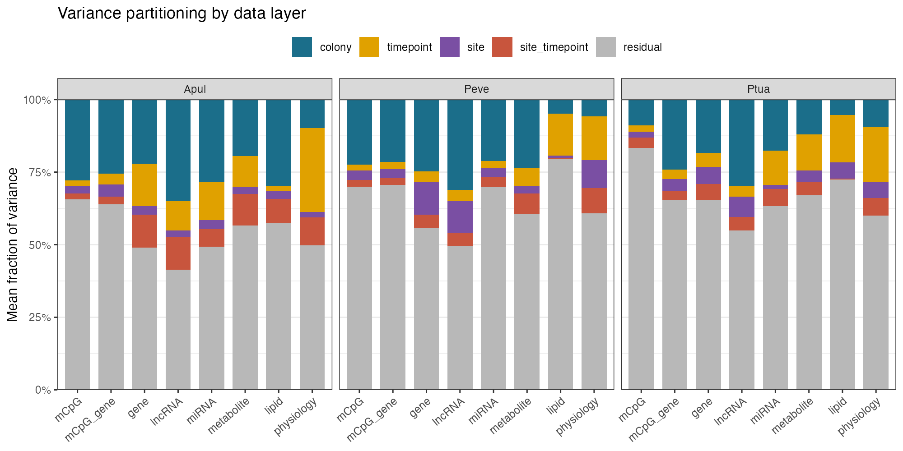
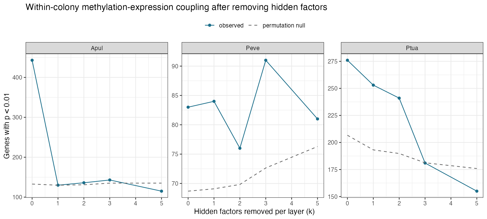
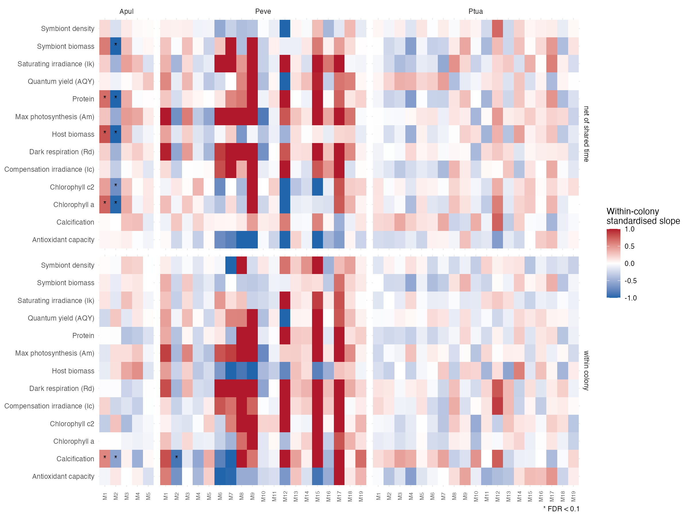
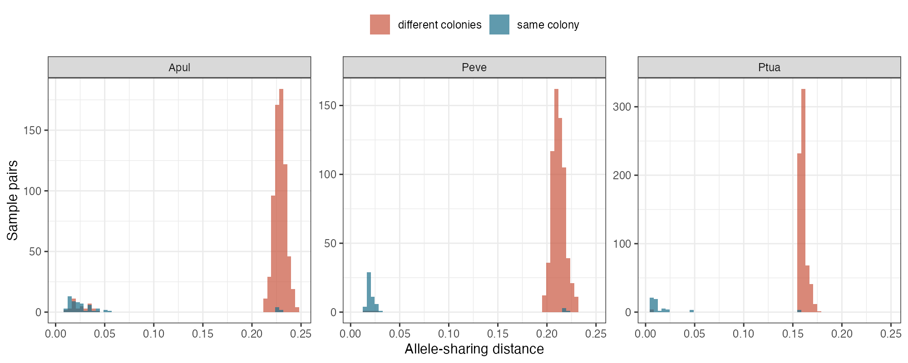
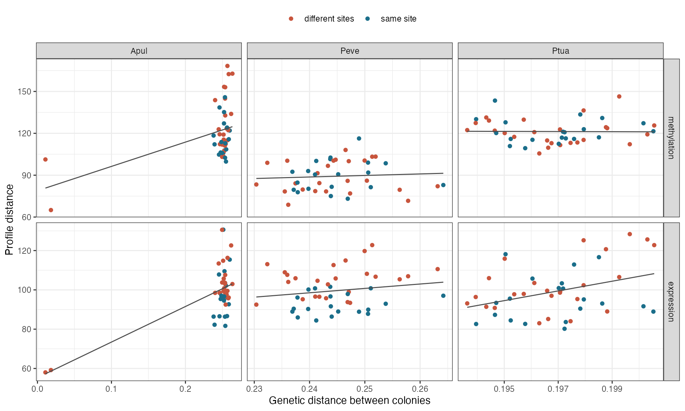

## The question

The E5 timeseries project sampled three corals four times over a year on Moorea:

-   *Acropora pulchra* (Apul)
-   *Porites evermanni* (Peve)
-   *Pocillopora tuahiniensis* (Ptua)

Each species has ten tagged colonies, five at Manava and five at Mahana, sampled at TP1–TP4. For the same samples we have:

-   gene and lncRNA expression, and miRNA
-   whole-genome bisulfite methylation
-   metabolites and lipids
-   13 physiology traits

The overarching question: **how do environment and epigenetics inform gene expression and physiology?** I worked through it in four steps, all in [`M-multi-species/scripts`](https://github.com/urol-e5/timeseries_molecular/tree/main/M-multi-species/scripts) of `timeseries_molecular` (scripts 55–58).

## 55 · What drives variation in each layer?

For every feature in every layer I fit a mixed model with colony, timepoint, site, and site × timepoint as random effects. I then took the share of variance each one explains.

-   **Methylation is a colony trait.** In methylated genes (≥5% mean methylation), colony explains 30–43% of the variance and time only 2–5%. Unmethylated genes are mostly noise.
-   **Expression is split.** Colony and time each explain a real share; for Apul genes, colony 22% and time 15%.
-   **Physiology is mostly time.** In Apul, timepoint explains about 29% and colony 10%. Season moves physiology more than identity does.
-   **Site explains almost nothing** on its own in any layer.

I also rolled per-CpG methylation up to gene bodies, requiring at least 10 CpGs per gene and sample. Methylated genes are more highly expressed (ρ 0.39–0.46 across genes) and less variable over time, which is the familiar invertebrate gene-body pattern.

## 56 · Does methylation track expression within a colony?

Genes that are methylated are also expressed. The sharper question is whether a gene's methylation *changes* with its expression when the same colony is followed through time. I removed colony means and shared site × time change, then correlated what was left gene by gene. The null came from shuffling methylation samples among timepoints within each colony (1,000 permutations).

At first Apul looked exciting: 443 genes at p \< 0.01 against 133 expected. Two things made me suspicious:

-   The correlations split evenly between positive and negative.
-   Peve and Ptua showed little excess.

So in **56.1** I added the top hidden factors from the residuals. Removing a single factor took Apul from 443 to 130 genes against 130 expected. Symbiont load, measured as cells per cm² and symbiont:host biomass, did not remove the excess.

**There is no robust gene-specific coupling of methylation and expression within colonies.** What looked like coupling was one sample-level axis shared by both layers.

## 57 · Expression to physiology, and thermal history

I built WGCNA networks (signed, 10,000 most variable genes per species) and related module eigengenes to physiology. Each eigengene was split into a between-colony part and a within-colony part.

-   **The Apul confound from 56 is a tissue-state axis.** Sample-wide methylation correlates with Apul modules M1 (+0.66) and M2 (−0.59). That axis tracks host biomass, symbiont biomass, and protein per cm², not surface area.
-   **Calcification relates to modules** in Apul (M1 and M2, FDR 0.017) and more weakly in Peve (M2, FDR 0.08), but not once shared seasonal change is removed. Expression and physiology mostly move together because they share the season.

-   **Thermal history.** I used logger temperature over the 7, 30, and 90 days before each sampling. Only saturating irradiance (Ik) tracked the 30-day mean temperature in Apul (r = 0.89, permutation p = 0.04). With only 8 site × time units it does not survive correction (FDR 0.34), so treat it as a lead.
-   **No cross-species concordance.** Across 9,017 one-to-one orthologs, 0 of 78 tests were significant at FDR \< 0.1, so the three corals don't respond to the year with the same genes.

## 58 · Is the colony methylation signal genetic?

If colony explains a third of methylation variance, is that just DNA sequence? Related colonies should have similar methylation, and C→T SNPs at CpGs read as unmethylated in bisulfite data.

I called SNPs from the RNA-seq reads in 3,000 moderately expressed genes per species. The reads were pulled straight from the BAMs on gannet with htslib range requests, so no full BAM was downloaded. That gave 421,504 SNPs for Apul, 256,923 for Peve, and 344,642 for Ptua. Every sample got its own genotype, so I could first check that a colony's four timepoints really are one animal.

### The flags

Samples from the same colony usually differ by an allele-sharing distance of 0.01–0.03. Different colonies differ by 0.15–0.25. I grouped samples into genotypes with a cutoff of 0.1, and two kinds of mismatch came up.

**Two colonies, one genotype: clones (Apul).** Ten Apul colonies collapse into eight genotypes:

-   ACR-145 (Manava) and ACR-265 (Mahana) are one genotype.
-   ACR-150 (Manava) and ACR-237 (Mahana) are another.

Branching *Acropora* spread by fragmentation, so I read these as clonemates, even across sites. They aren't errors, but they aren't independent colonies either.

**One colony label, two genotypes: likely sample mix-ups.** Cloning can't explain these. A clone gives two colonies the same genotype; it can't give one tagged colony a different genotype at a different timepoint.

| Sample | What it matches | Likely explanation |
|------------------------|------------------------|------------------------|
| ACR-145-TP2 | ACR-150/237 genotype | TP2 swap between ACR-145 and ACR-150 |
| ACR-150-TP2 | ACR-145/265 genotype | same swap |
| POR-245-TP3, TP4 | POR-236 (TP1–TP2) | POR-245 is a different genotype at TP1–TP2; mix-up or a neighbouring colony sampled at later visits |
| POC-57-TP4 | POC-53 | the other three POC-57 timepoints don't match POC-53 |

These five samples are left out of everything: 58 writes a sample-to-genotype table, and 55–57 read it, drop the five, and use genotype in place of colony. The Apul clonemate pairs count as one unit each, so Apul has 8 genotypes rather than 10 colonies. All numbers in this post are from that corrected run.

### Does methylation follow relatedness?

Colony profiles are colony means over time. I used Mantel tests with 9,999 permutations, and partial tests that control for site or genetics.

-   **Methylation vs genetics:** strong in Apul (r = 0.44, p \< 0.001), but driven by the clone pairs. With one colony per genotype it drops to r = 0.28, p = 0.10. Peve and Ptua show nothing (r = 0.07 and −0.01). Among distinct genotypes, methylation does not track relatedness.
-   **The clones are interesting in their own right.** Clonemates on different reefs have similar methylation, which suggests genotype shapes methylation even when the environment differs. A direct test of this is still to do.
-   **Expression vs genetics:** the clearest genetic signal, pooled r = 0.39, p = 0.0001, strongest in Ptua (r = 0.36).
-   **Physiology vs methylation:** Peve only (r = 0.37, p = 0.01). It holds after controlling for genetics.
-   **Physiology vs genetics:** nothing in any species.
-   **C→T SNPs at CpGs:** only 2–5 modelled CpGs per species overlap a SNP, too few to estimate any inflation.

Two practical notes for remote genotyping:

-   `bcftools query` output read with `fread` turns `13,0` allele depths into the decimal 13.0, so read those columns as text.
-   Long remote mpileup runs on gannet drop connections. 100-gene chunks with retries and resume fixed it.

## Where this leaves things

-   **Methylation** is a stable colony (or genotype) property. It is not explained by relatedness among distinct genotypes, and it barely moves with season.
-   **Expression and physiology** move mostly with season. Within a colony, expression doesn't follow methylation.
-   **Environment over the year** reaches physiology mostly through shared seasonal change. Thermal history shows up only in Ik.

## Rerun with corrected identities

The first pass of 55–57 used colony labels as given. After 58 I reran all of it without the five mismatched samples and with clonemates merged. The conclusions held:

| Result | First pass | Corrected |
|------------------------|------------------------|------------------------|
| Colony share, Apul gene-body methylation | 0.25 | 0.26 |
| Colony share, Apul expression | 0.18 | 0.22 |
| Apul within-colony coupling, genes at p \< 0.01 (expected) | 422 (140) | 443 (133) |
| Same, after removing one hidden factor | 143 (131) | 130 (130) |
| Apul M1/M2 vs calcification, FDR | 0.03–0.04 | 0.017 |
| Peve M2 vs calcification, FDR | 0.044 | 0.08 |
| Apul Ik vs 30-day temperature, permutation p | 0.004 | 0.04 |
| Ortholog tests significant | 0 of 78 | 0 of 78 |

Colony shares went up a little almost everywhere, which is what you'd expect once misassigned samples stop adding noise to colony means. The thermal Ik result got weaker.

Next:

1.  Identify the hidden factor behind the Apul within-colony coupling: technical (depth, RNA quality, conversion) or biological (symbiont fraction, tissue state)?
2.  Directly compare methylation between clonemates on different reefs.
3.  Bring metabolites and lipids into the same colony-versus-time framework.

Code: [55–58](https://github.com/urol-e5/timeseries_molecular/tree/main/M-multi-species/scripts) · [PR #141](https://github.com/urol-e5/timeseries_molecular/pull/141) (58) and [PR #142](https://github.com/urol-e5/timeseries_molecular/pull/142) (corrected rerun).
