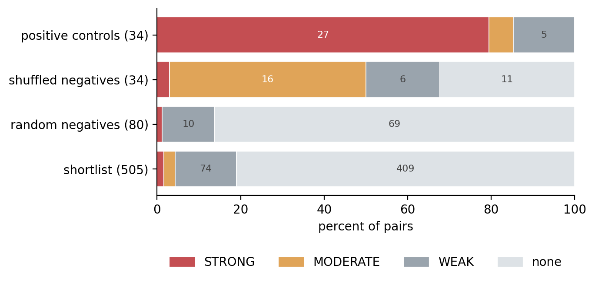
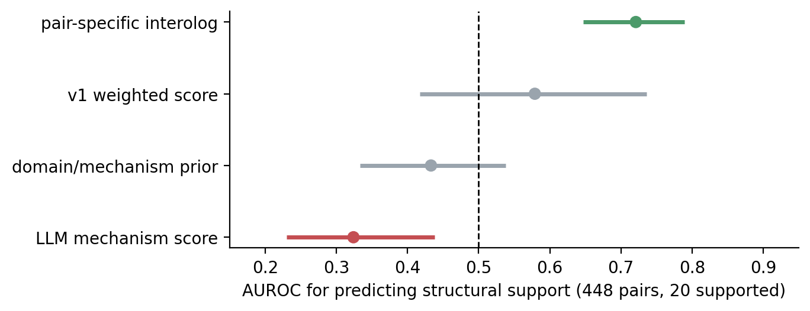
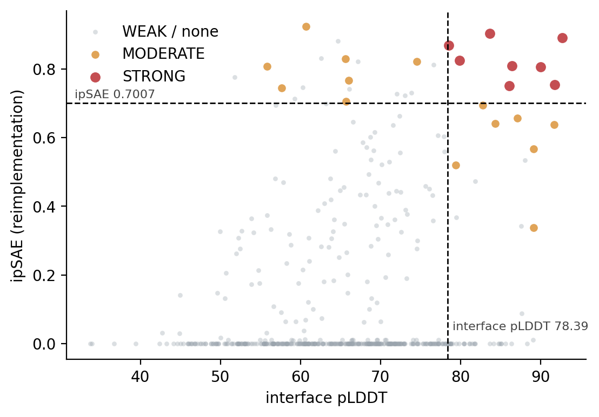

## What this is

An end-to-end attempt to predict which *Caligus rogercresseyi* secreted proteins contact which *Salmo salar* proteins at the skin, mucus and blood interface. Four evidence channels scored candidate pairs, a shortlist went to Boltz-2 co-folding on Hyak, and a set of controls decided what the interface metrics mean. The interesting part is not the hit list. It is that three of the four channels turned out to have no pair-level power, and the controls are what showed it.

## Building the pieces

| Component | Result |
|----|----|
| Louse working proteome | 39,721 proteins, BUSCO C:91.0% |
| Predicted secretome | 4,566 proteins (tier A 1,759 / B 2,446 / C 361) |
| Salmon interface set | 2,799 genes / 1,682 ohnolog groups; 735-gene priority subset |
| Ranked pairs | 55,735 scored, all channels kept separate |
| Top-50 audit | 33/50 unflagged |

The only annotated *C. rogercresseyi* assembly (GCA_013387185.1) has a protein set that fails QC outright: BUSCO C:15.7%, median protein 94 aa, 8,995 "partial" deflines. The cause was measured rather than assumed. **78.9% of miniprot models on this assembly cross at least one frameshift** (mean 3.54 per model), which is an assembly-level indel defect. Translating the deposited transcriptome (TSA GAZX01, from ENA since the NCBI `wgs_aux` path 404s) and reconciling ORFs against the genome models at 95% identity, preferring 5'-complete non-frameshifted representatives, brought completeness to C:91.0%.

That matters more than it sounds. Signal-peptide prediction reads the N-terminus, so the unrepaired set would have made roughly 38% of secretome calls artefacts.

## Two channels rank kinds of pairing, not pairs

Each sequence channel was tested against 50,000 uniform-random louse–salmon pairs drawn from the same two sets.

-   **Domain/mechanism** (109 curated rules, 3did DDI reference): enrichment **1.01** at combined prior ≥ 0.3 and **0.85** at ≥ 0.9. No discrimination at all. That is structural, not a defect in the rules: the score is a function of each protein's class, so every louse serpin × host serine protease pair scores alike whether or not it is real.
-   **LLM mechanism judgement** (58,735 pairs scored blind, 3,000 background pairs hidden among them): looks strong, with background mean 0.051 vs selected 0.130 and AUROC 0.897. But **within a matched (louse class, MEROPS, salmon module) cell the background-minus-selected difference is −0.0017**. It is a better class discriminator than the rule table and nothing more.
-   **Interolog transfer** is genuinely pair-specific but sparse. 536 pairs reach ≥ 0.5 where no random pair exceeded 0.496, but **313 of those are conserved-core transfers** (ribosomal protein SA, RUVBL1, CDC42) that project intracellular interactions onto a secretome. **223 remain.**

Under 50 draws of 25% weight perturbation the ordering is robust (Spearman 0.984) but top-100 membership is not (mean overlap 76.6, range 37–97). Read the ordering, not the membership of any cut.

## The structural run

1,059 Boltz-2 runs over 653 pairs completed on klone with zero failures and zero OOM fallbacks, so no run is excluded for settings drift. The campaign came in well under the estimate: 215 batches across 32 A40 tasks, **22.8 h of A40 prediction time** (27.2 GPU-h of task wall), finishing in 3.2 h of campaign wall on the checkpoint queue against the \~80 GPU-h the bundle predicted. 34 positive controls (verified host–parasite PDB complexes, re-folded) went against 80 random and 34 shuffled negatives on identical settings.

| metric              | AUROC vs random | vs shuffled |
|---------------------|-----------------|-------------|
| pDockQ2             | 0.990           | 0.887       |
| ipSAE (reimpl.)     | 0.981           | 0.883       |
| interface pLDDT     | 0.971           | **0.971**   |
| cross-group ipTM    | 0.972           | 0.725       |
| pDockQ              | 0.804           | 0.835       |
| buried surface area | **0.334**       | 0.458       |

Two things worth keeping:

-   **pDockQ is unusable here.** Its median is 0.742, its mathematical ceiling, in *every* class including random negatives. No threshold exists.
-   **Buried surface area is anti-predictive** (0.334). Random pairs of large proteins bury more area nonspecifically than real complexes of modest size. It stays as a descriptive column only.

The two negative sets are not equivalent. Shuffled controls keep their native host chains and score well above random on the PAE metrics (median cross-group ipTM 0.605 vs 0.271). Interface pLDDT is the only metric that separates them cleanly, because a shuffled chain docks but docks *unconfidently*. So the call uses one metric from each family:

> **STRONG** = ipSAE ≥ 0.7007 **and** interface pLDDT ≥ 78.39 **MODERATE** = ≥3 of the four thresholded metrics pass

STRONG recovers **27 of 34 positive controls** (79.4%) at 1 of 80 random and 1 of 34 shuffled negatives.

One caveat on that denominator: **the effective number of positive controls is nearer 16 than 34**, because 16 of the 34 are thrombin complexes. Thresholds were also set against random negatives only, and seed depth differs between classes, so the seed-matched recalibration in the dashboard is the stricter read.

The shuffled negatives are the instructive bar: they dock readily (16 of 34 reach MODERATE) and are held out almost entirely by the interface pLDDT term.

## The pre-registered channel test

Before the run I said the LLM channel's unvalidated within-class residual would be tested against structure, and its weight zeroed if it failed. Within the 448 shortlist pairs matched to the v1 ranking (20 structurally supported):

| channel                         | AUROC     | 95% CI          | verdict          |
|---------------------------------|-----------|-----------------|------------------|
| pair-specific interolog         | 0.721     | 0.647–0.789     | **above chance** |
| combined domain/mechanism prior | 0.433     | 0.333–0.538     | chance           |
| **LLM mechanism score**         | **0.324** | **0.230–0.438** | **below chance** |
| v1 weighted score               | 0.579     | 0.417–0.736     | chance           |

**The LLM channel failed in the informative direction.** It is significantly *anti*-correlated with structural support, rating the eight STRONG pairs at mean 0.09 and calling most of them "none_plausible". Its weight is now zero. The domain/mechanism prior is indistinguishable from chance, consistent with its 1.01 enrichment earlier. Only interolog transfer, the one channel that was ever pair-specific, predicts structure — and even that is not clean independent validation, since `il_pair_specific` enters the structural rank score as a tiebreak term and was used to select the T1 shortlist tier.

## What the structure found

8 shortlist pairs reach STRONG and 14 more MODERATE, of 505 folded.

| pair | tier | ipSAE | if-pLDDT | mechanism |
|----|----|----|----|----|
| Crog2_030737 × trypsin-2 (*trp-ii*) | STRONG | 0.90 | 92.7 | louse Kazal inhibitor vs host trypsin |
| Crog2_002777 × **TIMP2** | STRONG | 0.87 | 78.5 | louse M10 metallopeptidase vs host metalloprotease inhibitor |
| Crog2_022439 × **factor IX** | STRONG | 0.75 | 86.1 | louse Kunitz vs coagulation protease |
| Crog2_033262 × **factor X** (*f10*) | MODERATE | 0.69 | 82.8 | louse Kunitz vs FXa, the ixolaris precedent |
| Crog2_021270 × lysozyme (*lyz*) | MODERATE | 0.52 | 79.4 | louse CBM_14 chitin-binding vs host lysozyme |

These five carry the `REVIEW CORE` flag in the candidate table: a named mechanism on both sides and a fold pairing with precedent. The other four STRONG hits (inorganic pyrophosphatase, plasma alpha-L-fucosidase, glucosidase 2 subunit beta, microsomal triglyceride transfer protein) are all flagged **conserved/homologous complex** — the model is likely recovering a known fold pairing rather than a parasite–host interaction, so they rank high without meaning much.

Each point is one folded shortlist pair; dashed lines are the two thresholds. The STRONG set is the upper-right quadrant, and the MODERATE points to the left of the pLDDT line are the ones that dock confidently by PAE but not by local confidence.

The trypsin-II pair is the strongest result in the project: rank 1 on sequence evidence and rank 3 on independent structural evidence, from two channels the data show are otherwise poorly correlated. The TIMP2 and Kunitz–coagulation pairs match the inhibitor-fold compatibility table built from the tick literature, which was never fitted to anything here.

Three artefact patterns, not findings. Louse protein Crog2_029252 is a 59-aa **Integrin_beta** fragment and accounts for 4 of the 22 tiered hits (10 across the shortlist), every one against a salmon integrin alpha subunit — that is the model rebuilding the canonical integrin αβ heterodimer, not a secreted effector. And salmon *llph* appears in 4 MODERATE hits whose louse partners are all **ribosomal proteins rescued into the secretome by a de novo signal-peptide call**, at high ipTM but low interface pLDDT (55–66). A third, HRas, is a cytoplasmic lipid-anchored protein that a secreted louse protein never meets. All are artefacts, and the STRONG pLDDT term already excludes the *llph* set. After this review roughly **5 of the 22 tiered pairs survive**.

## The data

Both the browsable results and the underlying table ship with this post:

-   [**`ppi_results_dashboard.html`**](data/ppi_results_dashboard.html) — a self-contained dashboard (open it in a browser, no server needed): the GPU campaign timeline batch by batch, control calibration with the metric scatter and thresholds drawn, the as-used vs seed-matched recalibration table, the channel AUROCs, and a sortable, searchable table of all 505 candidates with a filtered-TSV download.

-   [`ppi_dashboard_candidates.tsv`](data/ppi_dashboard_candidates.tsv) — all **505 folded pairs**, one row each: louse protein and its secretome tier and Pfam domains, salmon symbol and product name, accessibility class, which selection tier put the pair in the shortlist, the five interface metrics, the three sequence-channel scores, and the review flags.

Two columns are worth knowing before reading it:

-   **`selection_tier`** — why the pair was folded at all: `T1_interolog_pair_specific` (222), `T2_top_combined_prior` (140), `T3_mechanism_representative` (96), `T4_resistance_target` (47). Given the channel results above, T1 is the only tier with demonstrated pair-level support.
-   **`accessibility_class`** — whether the host partner is actually reachable by a secreted louse protein: `secreted` (217), `pm_ectodomain` (142), `secreted_ecm` (60), plus smaller classes where the signal peptide is a feature-rule or de novo call (`secreted_sp_feature` 39, `secreted_denovo` 21, `pm_ectodomain_denovo_noSP` 18). The de novo classes are where the *llph* artefacts live.

**`review_flags`** is the column to filter on first. `REVIEW CORE` marks the five pairs above; `conserved/homologous complex`, `promiscuous louse chain`, `de novo SP rescue` and `topology: cytoplasmic/lipid-anchor` each mark a reason a high score may not mean a real host–parasite interaction. `MODERATE tier (47% shuffled FPR)` is a reminder that MODERATE is a weak call by construction.

## The honest negative result

**The shortlist is not significantly enriched for structural support over random pairs**: 1.6% STRONG (8/505) vs 1.2% (1/80), Fisher OR 1.27, p = 0.65. Including MODERATE, 4.4% vs 1.2%, OR 3.60, p = 0.15. Suggestive, not significant.

So the sequence channels did not enrich the shortlist for structurally plausible pairs. The pipeline worked as a *screen*, reducing 12.78 M pairs to 505 affordable ones among which structure found 22 worth attention, but it did not demonstrate predictive power at pair level. A differently chosen 505 might have done as well.

## Other things established along the way

-   **The LGP gap is an annotation artefact, not an absence.** Labial gland proteins LGP1–4 have the strongest functional precedent of any sea-louse effector, yet only 3 *C. rogercresseyi* homologues are detectable. The family is domainless and fast-evolving with no paralogue even within the *L. salmonis* genome, which is exactly what ortholog transfer under-recovers across genera. Meanwhile 187 of our secretome proteins do hit *L. salmonis* labial-gland queries. Score LGP mechanisms as "plausible but undetected", never "absent".
-   **Resistant-species targets:** hepcidin/HAMP1, complement C3, CLEC4M, CHIA and the coho chitin-sensing receptor set differ between resistant (coho, pink) and susceptible (Atlantic) salmonids. Hepcidin/HAMP is absent from our 2,799-gene interface set, so it could not be paired. That is a gap in the host set, not evidence against it.

## Limits that travel with every number here

1.  **No *C. rogercresseyi* E/S proteome exists.** Every secretion call is prediction plus ortholog transfer from the single *L. salmonis* E/S proteome (Hamilton 2018, 187 proteins).
2.  **Tier B (2,446 of 4,566) is a candidate pool, not a call set.** Its second signal-peptide opinion is a von Heijne weight rule, not a trained predictor.
3.  **Host compartment coverage measures sampling depth.** Skin (2,494 genes) rests on one snRNA-seq library; only mucus (561) and blood (223) have proteomic evidence, and no *S. salar* plasma proteomics exists in PRIDE at all.
4.  **No *C. rogercresseyi* expression data was obtainable**, so all infestation responses are *L. salmonis* proxies.
5.  **41.6% of the secretome has no Pfam domain,** so the DDI channel is blind to it.
6.  **Catalytic "degraded" flags mostly reflect 5'-partial ORFs**, not genuinely inactive homologues.
7.  **The positive controls are thrombin-heavy.** 16 of 34 are thrombin complexes, so the sensitivity figure rests on fewer independent complexes than the count suggests.

## Next

1.  **Test the trypsin-II, TIMP2 and Kunitz–coagulation pairs first.** Convergent evidence, named mechanisms, obvious assays: inhibition kinetics against the specific host enzyme.
2.  **Treat the remaining STRONG hits as structure-only leads.** Several have `functional_class=unknown` on the louse side, so identify those proteins before investing.
3.  **Spend any future GPU budget differently.** These results argue for co-folding a broader, less pre-filtered set, since the filters added little. Folding all tier-A secretome × priority-interface pairs would beat a cleverly chosen subset.
4.  **Pull-down of louse secretion products against salmon skin-mucus and plasma by LC-MS/MS.** This would supply the *C. rogercresseyi* E/S proteome the field lacks, which remains the single most valuable missing dataset for this question.
